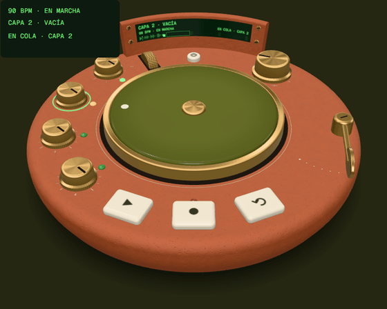
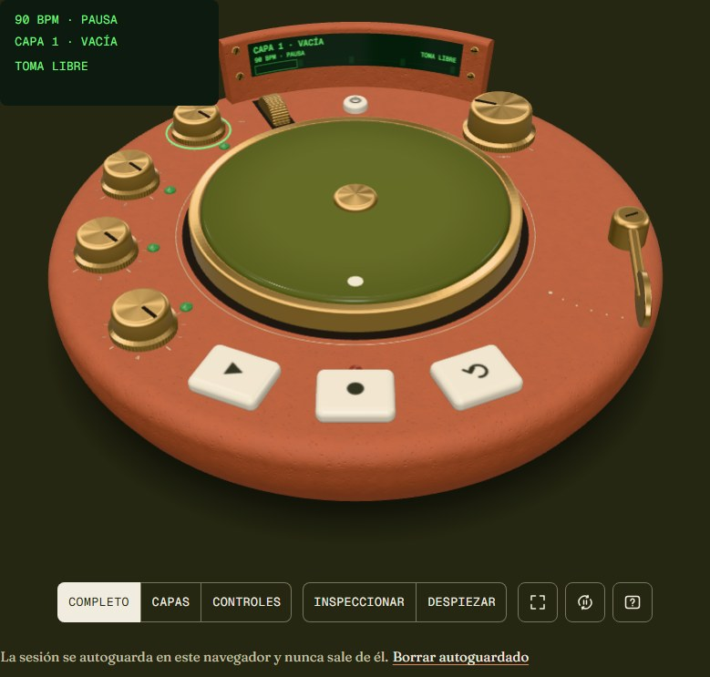
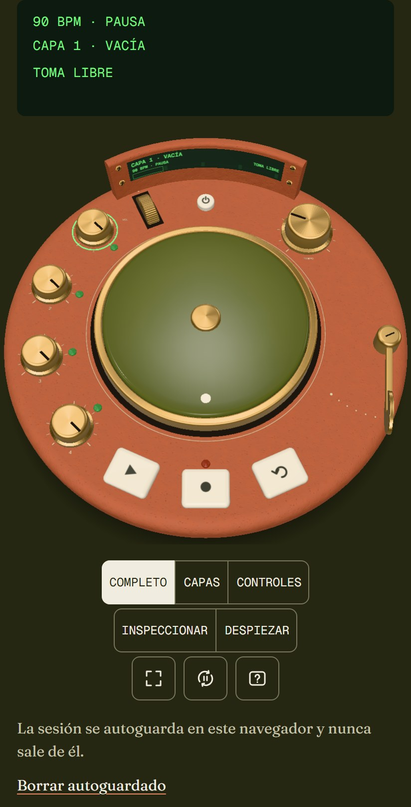
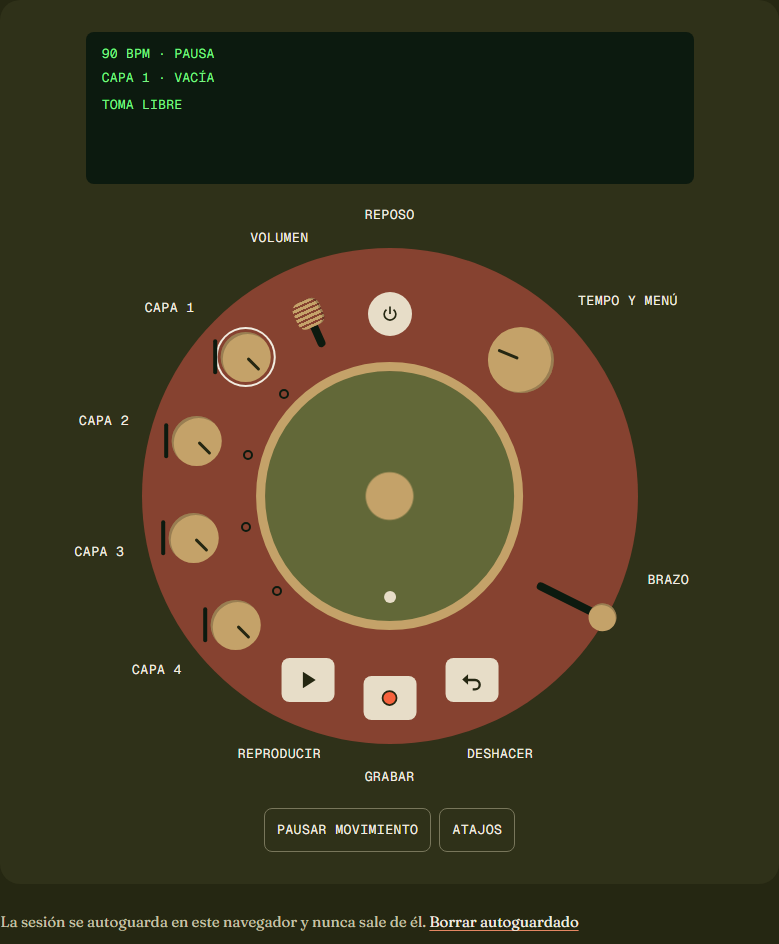

# Torno

**Un instrumento de bucles de cuatro capas, en 3D, que se toca en el navegador.** Cuatro capas que se repiten sobre el mismo compás: una batería, un bajo, unos acordes, una textura o lo que grabes con el micrófono. Se toca girando diales, pulsando teclas, agarrando un disco para arrastrar el tiempo y bajando un brazo que filtra el sonido. Todo el audio es propio (Web Audio API y AudioWorklet, sin librerías) y nunca sale del dispositivo.

Pieza de portfolio de [Iván Chesa Lapena](https://ivanchesa.com), desarrollador de software.

- **Vista previa:** [staging.torno.pages.dev](https://staging.torno.pages.dev) (sin indexar). En producción irá en `torno.ivanchesa.com`.
- **Caso de estudio:** la página [`/sobre-el-proyecto`](https://staging.torno.pages.dev/sobre-el-proyecto) cuenta la arquitectura del audio, las decisiones y las mediciones.

<p align="center">
  
</p>

## Qué hace

- **Cuatro capas en bucle**, cada una con su dial: girar = nivel, pulsar = seleccionar, mantener = silenciar. Reverso, panorama y filtro por capa.
- **Doce bucles propios**, sintetizados en el navegador con código determinista (Re menor, 90 BPM): ni muestras ni audio generado por IA.
- **Grabación con el micrófono**: toma libre o de 1, 2 o 4 compases, cuenta previa, metrónomo y sobregrabación, con **compensación de latencia** automática y calibración por clics.
- **Tempo de 40 a 240 BPM** (*varispeed*, con interpolación cúbica), tempo por pulsaciones y tempo a partir de la primera toma.
- **Disco** que congela la capa y la arrastra adelante o atrás; **brazo** que la filtra con un filtro de variables de estado.
- **Deshacer y rehacer** (3 estados por capa), **cambios de sonido en cola** hasta el siguiente compás y exactos a la muestra.
- **Proyecto `.torno`** para guardar y cargar, **WAV estéreo de 24 bits** de la mezcla y de cada pista, y **autoguardado** local con recuperación.
- **Un aparato 3D de verdad**: se gira, se inspecciona, se despieza y la cámara viaja hasta cada control desde la guía.
- **Accesible**: cada pieza del 3D es un elemento HTML enfocable con su etiqueta en español; todo se toca con teclado, con lector de pantalla y **sin WebGL** (el plato HTML).
- **Privado**: 0 cookies, 0 analítica, 0 peticiones a terceros y 0 peticiones de red al grabar, guardar o exportar.

## Capturas

| El aparato en 3D (escritorio) | En el móvil | Sin WebGL: el plato HTML |
|---|---|---|
|  |  |  |

Más capturas, deterministas (`?captura=1`) y por fase, en [`docs/informes/img/`](docs/informes/img/): las vistas del aparato ([fase 8](docs/informes/img/fase-8/escenario-vistas-escritorio.jpg)), los encuadres ([fase 8](docs/informes/img/fase-8/instrumento3d-encuadres-escritorio.jpg)) y la web entera ([portada](docs/informes/img/fase-8/inicio-escritorio.png), [caso de estudio](docs/informes/img/fase-8/sobre-el-proyecto-escritorio.png)).

## Stack

- **Angular 22**: componentes *standalone*, *zoneless* y *signals*, prerenderizado estático (`outputMode: "static"`) y `@defer` para todo lo que no se ve en la primera pantalla.
- **TypeScript estricto**, sin `any`.
- **Audio propio**: Web Audio API, un **AudioWorklet** con un núcleo DSP escrito desde cero (`LoopCore`) y *workers* para sintetizar y exportar. Sin Tone.js ni librerías de audio.
- **Three.js 0.186**, directo y sin envoltorios: el aparato es **procedural** (geometría y texturas generadas por código, sin modelos ni texturas que descargar), con materiales físicos, `RoomEnvironment` y render bajo demanda (0 fps en reposo).
- **CSS propio** con *custom properties* (dirección visual «Barro»), sin librerías de UI.
- **Pruebas**: Vitest en Node (el núcleo de audio a nivel de muestras, la síntesis, los formatos de archivo y el modelo del instrumento), Vitest con jsdom (Angular), Playwright en Chromium y WebKit con micrófono sintético y AudioWorklet real, axe, regresión visual y Lighthouse en el CI.
- **Cloudflare Pages** con GitHub Actions: se publica el build que ya ha probado el CI, con las acciones fijadas por SHA.

## Arquitectura

```
        hilo principal                                    hilo de audio
 ┌───────────────────────────────┐   mensajes tipados   ┌────────────────────────────┐
 │ Angular (features, pages)     │ ───── comandos ────▶ │ AudioWorklet               │
 │   │                           │                      │   LoopCore (TS puro):      │
 │   ├─ instrument/  (TS puro)   │ ◀── eventos ≤ 30/s ─ │   transporte, 4 capas,     │
 │   │   controles, gestos, menú │   (posición, niveles)│   grabación, cola, disco,  │
 │   ├─ scene/  (Three.js)       │                      │   filtro SVF, limitador    │
 │   └─ audio/engine/            │                      └────────────────────────────┘
 │       AudioContext, micro,    │   workers: síntesis de los bucles · exportación WAV
 │       archivos, autoguardado  │   (el mismo LoopCore: lo que suena es lo que se exporta)
 └───────────────────────────────┘
```

- **Un solo reloj**: el contador de muestras del worklet. La animación del 3D lee la posición del transporte; nunca al revés. El disco da una vuelta por compás.
- **Capas vigiladas por el lint** (`no-restricted-imports`): `audio/core`, `audio/synth`, `audio/files` e `instrument` son TS puro (sin DOM, sin Web Audio y sin Angular) y se prueban en Node; `three` solo se importa en `scene/`; los componentes llegan al audio y al 3D por una API diminuta que carga la implementación con `import()`.
- **Un único modelo del instrumento** (`instrument/`) alimenta el 3D, el plato HTML y la guía.
- **Controles HTML proyectados**: cada pieza del 3D lleva encima un `button` o un `role="slider"` en su posición de pantalla. Puntero, dedo, teclado y lector de pantalla usan el mismo elemento.
- **Hilo de audio sin asignaciones**: `process()` no reserva memoria, no usa `async` ni crea cierres; todo parámetro que cambia en directo se suaviza (ni clics ni chasquidos).
- **Carga**: el texto y un póster del aparato se prerenderizan; el motor de audio, la síntesis y el 3D nunca van en el bundle inicial. El 3D llega con el primer gesto o con la página quieta.

Más detalle: el plan ([`docs/PLAN.md`](docs/PLAN.md) §4), el audio ([`docs/AUDIO.md`](docs/AUDIO.md)) y el diseño ([`docs/DISENO.md`](docs/DISENO.md)).

## Cifras medidas

Solo cifras medidas, cada una con su informe (donde está cómo se midió).

| Qué | Medido | Dónde |
|---|---|---|
| CPU del núcleo de audio (4 capas, filtros y limitador) | **218–232×** el tiempo real en Node (60 s de audio a 48 kHz en 259–275 ms); 35× en el peor caso a 240 BPM | [fase 7](docs/informes/fase-7.md) §6 |
| Del gesto al cambio en el audio | mediana de **0,4 ms** (tecla) y **3,9 ms** (dial), con el 3D pintando | [fase 6](docs/informes/fase-6.md) |
| Primer sonido con el motor cargado | **10–15 ms** hasta la primera muestra en la salida (20 medidas, sin la latencia del dispositivo) | [fase 2](docs/informes/fase-2.md) |
| Primer toque de una visita nueva, por red | **205–225 ms** hasta los altavoces (escritorio, con la latencia de salida) | [fase 8](docs/informes/fase-8.md) §6 |
| Toma alineada tras calibrar | a **2 muestras** (0,04 ms) de su sitio, con el micrófono sintético | [fase 2](docs/informes/fase-2.md) |
| Exactitud | cola y tomas exactas a la muestra, deriva 0 en 10 min (tests del núcleo) | [fase 1](docs/informes/fase-1.md) · [fase 8](docs/informes/fase-8.md) §6 |
| Lighthouse móvil (`/`, mediana de tres en el CI) | **99** rendimiento · **100** accesibilidad · **100** buenas prácticas; LCP 1,8 s, CLS 0,001 | [fase 8](docs/informes/fase-8.md) |
| Primera visita a la portada, en bruto | **565 kB** sin el 3D · **1,37 MB** con él | [fase 8](docs/informes/fase-8.md) §6 |
| JS inicial de `/` · chunk 3D | 318,5 kB · 658,4 kB | [fase 8](docs/informes/fase-8.md) §6 |
| 3D en el escritorio (RTX 3060) | 144 fps en los tres niveles; generación del aparato en 81–113 ms; 0 fps en reposo | [fase 8](docs/informes/fase-8.md) §6 |
| Accesibilidad | axe: **0 violaciones** en las tres rutas, el móvil, a 320 px y con el zum al 200 % | [fase 8](docs/informes/fase-8.md) |
| Privacidad | 0 cookies · 0 peticiones a terceros · 0 peticiones al grabar, guardar o exportar (e2e) | [fase 8](docs/informes/fase-8.md) §6 |

## Cómo se ha hecho

Por fases, con un plan escrito antes de programar y una revisión independiente al final de cada una:

- [`docs/PLAN.md`](docs/PLAN.md): el plan maestro (alcance, decisiones, arquitectura, presupuestos de calidad y fases).
- [`docs/informes/`](docs/informes/): el informe de cada fase, con sus criterios de aceptación demostrados, cifras y capturas; y el [diario](docs/informes/DIARIO.md).
- [`docs/revisiones/`](docs/revisiones/): las revisiones de cada fase y de cada bloque.
- [`CHANGELOG.md`](CHANGELOG.md): lo que trae cada versión.

## Comandos

- `npm start`: servidor de desarrollo (compila el worklet en modo vigilancia). Con `-- --host 0.0.0.0`, accesible desde el móvil en la red local.
- `npm test`: tests unitarios (Vitest en Node para el núcleo de audio y Vitest con jsdom para Angular).
- `npm run lint`: tipos de cada capa, ESLint (con las capas de la arquitectura) y Prettier.
- `npm run build`: build estático con prerenderizado en `dist/torno/browser`, preparado para Cloudflare Pages (rutas como `ruta.html`, `404.html` y `_headers` con la CSP).
- `node scripts/serve-pages.mjs`: el build en `http://localhost:4300`, servido por `wrangler pages dev` como en Cloudflare Pages (`npm run build` antes).
- `npm run e2e`: Playwright (Chromium y WebKit) contra `ng serve` y contra el build servido como en Pages (`npm run build` antes).
- `npm run check`: lint, tests, build, presupuestos de tamaño y límites de Pages. Obligatorio antes de cerrar una fase.
- `npm run capturas -- --fase=N`: capturas deterministas (`?captura=1`) en `docs/informes/img/fase-N/` (`npm run build` antes).
- `node scripts/readme-gif.mjs`: el GIF de este README, grabado del build con la GPU (`npm run build` antes).
- `node scripts/render-poster.mjs`: las imágenes de la web renderizadas con el propio motor (los pósteres del 3D, los renders de las secciones y la imagen Open Graph) en `public/img/` (`npm run build` antes y después).
- `node scripts/loop-anatomy.mjs`: las formas de onda de «Anatomía de un bucle», con la misma síntesis (si cambia un sonido).
- `node scripts/capture-maqueta.mjs`: las capturas de la maqueta de la portada (`docs/maqueta/`).
- `node scripts/verify-pages.mjs <URL> [--build dist/torno/browser]`: comprueba un despliegue como con `curl` (rutas, redirecciones, 404, cabeceras, caché y que sirve ese build).

Requisitos: Node 22.22.3 o superior (o 24.15+). Para el e2e, `npx playwright install chromium webkit` la primera vez.

## Despliegue

Cloudflare Pages, proyecto `torno`. Siempre se publica **el build que ya ha probado el CI**:

- Cada *push* a `main` con el CI en verde va a la vista previa [`staging.torno.pages.dev`](https://staging.torno.pages.dev) (`.github/workflows/deploy.yml`), que después se comprueba.
- Un *push* a una rama de fase (`fase-*`) va a su propia vista previa, `https://<rama>.torno.pages.dev`, para probarla en el móvil antes de fusionar.
- **Producción** (`.github/workflows/production.yml`): una etiqueta `vX.Y.Z` en un commit de `main` (con la misma versión en `package.json`) publica el build del CI de ese commit en la rama de producción, `torno.pages.dev` y `torno.ivanchesa.com`. Se puede probar en seco, sin publicar nada: `gh workflow run production.yml -f etiqueta=main`.

## Licencia

El **código** está bajo la [licencia MIT](LICENSE), © 2026 Iván Chesa Lapena.

Quedan **fuera** de la licencia MIT, con todos los derechos reservados (lo resume [`NOTICE`](NOTICE)):
- la **marca** «Torno» (el nombre y su icono);
- los **textos de la web**: el contenido de las páginas (portada, guía, detalles, anatomía de un bucle, ficha técnica, preguntas frecuentes, cierre, caso de estudio y 404), en `src/app/core/site.content.ts`, `src/app/app.content.ts`, `src/app/app.routes.content.ts`, `src/app/features/product/*.content.ts` y `src/app/pages/**/*.content.ts`;
- las **imágenes**: las de `public/img/`, `docs/img/` y `docs/informes/img/`, y la imagen Open Graph.

Los textos de la interfaz del instrumento (las etiquetas de los controles, la pantalla, los avisos y el diagnóstico, en el resto de los `*.content.ts`) son parte del código y van con la MIT: sin ellos, el instrumento no funciona.

Las fuentes (Fraunces y Geist Mono) son de sus autores, con la licencia SIL Open Font License 1.1 ([`docs/FUENTES.md`](docs/FUENTES.md)). Los sonidos se generan con el propio código.

## Inspiración

Inspirado en [TAPE, de Ethan](https://tape.ethanplus.ai). De él viene la idea de un instrumento de bucles que se toca en la web; el código, los sonidos, los textos y el diseño de Torno son propios.
