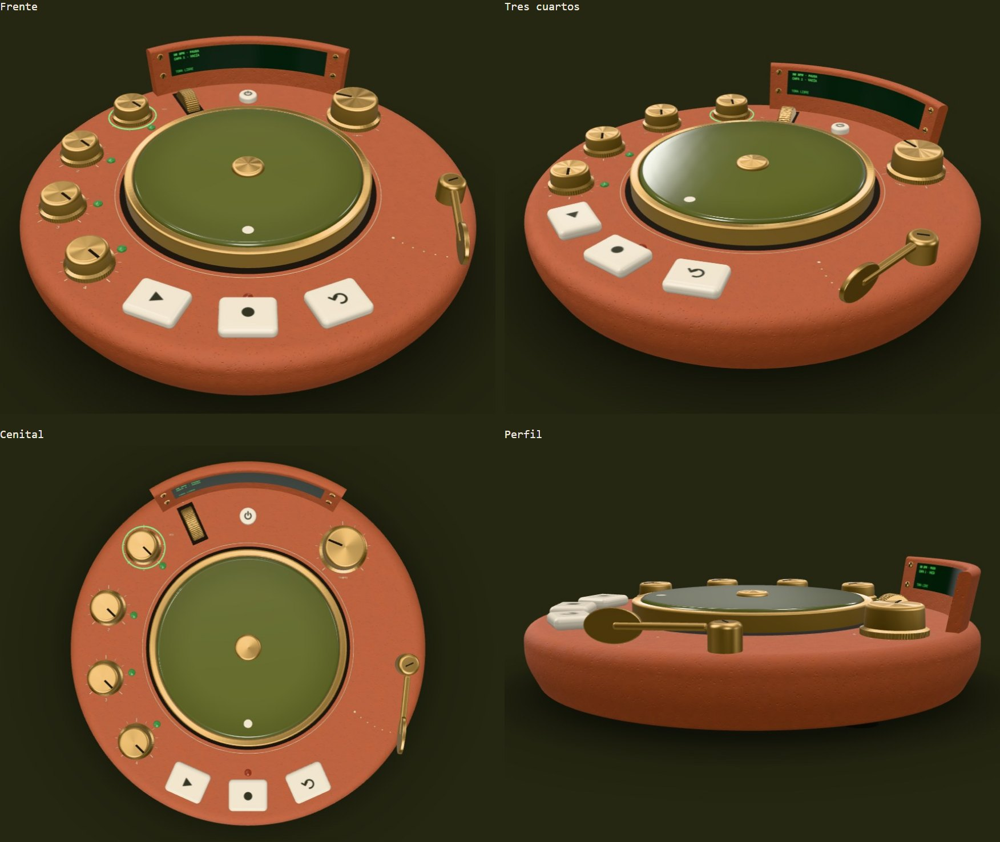
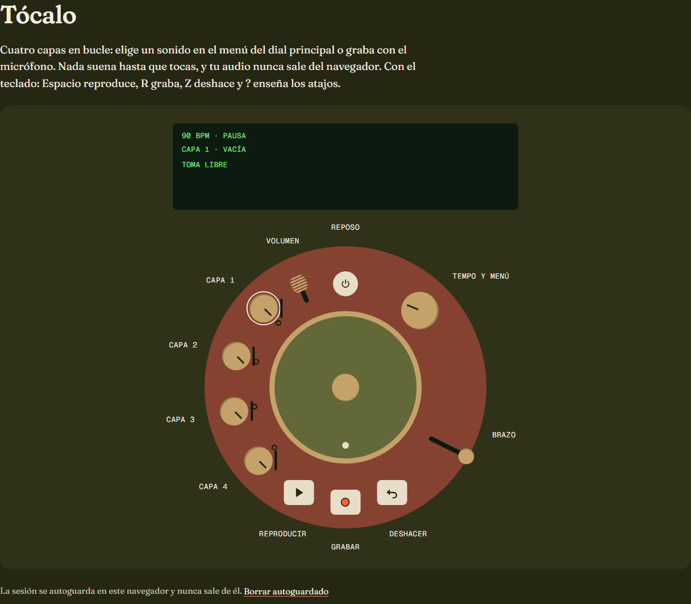
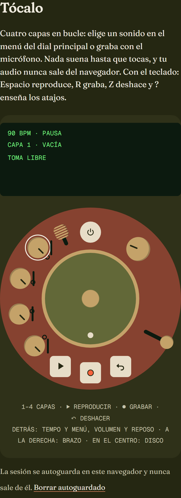
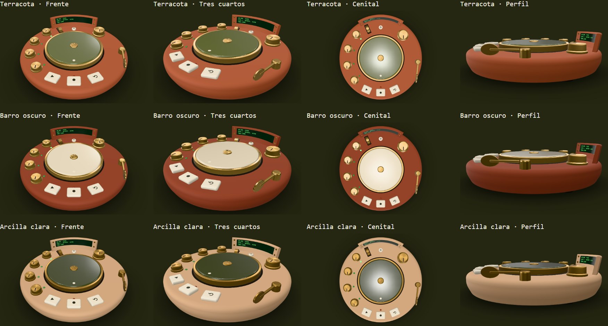
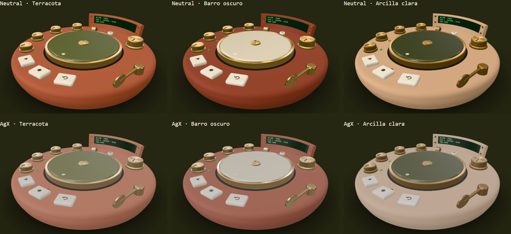
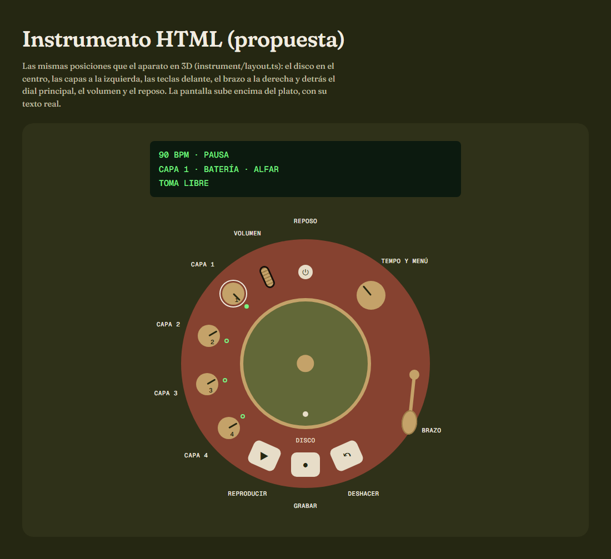

# Informe: Fase 5 (diseño del instrumento y modelo 3D)

- **Rama:** `fase-5-modelo-3d`
- **Fecha:** 2026-10-30 (5.a y 5.b)
- **Estado:** entregas 5.a y 5.b terminadas (el diseño, aprobado por Iván tal cual el 30-10; las pruebas del móvil, en `docs/PRUEBAS-MOVIL.md`). Pendiente de la revisión de la fase y de la fusión.

## 0. Plan de la fase

**Antes de la fase, en `main`** (revisión del bloque B, fase 4; respuesta al final de `docs/revisiones/bloque-B.md`):
- la precarga de ALFAR al acercarse al instrumento (`765ba8a`);
- las vistas previas de las ramas `fase-*` (`7bd30da`): gracias a ellas, esta rama se publica en `https://fase-5-modelo-3d.torno.pages.dev`;
- el PR #1 de Dependabot (`3bc5bbb`).

**Entrega 5.a: maqueta** (esta sesión; termina con la PARADA):

1. **Medidas y distribución propias, en mm** (`src/app/instrument/layout.ts`, TS puro: la misma fuente para el 3D, el instrumento HTML y la guía). La idea sale del nombre: **un torno de alfarero visto desde arriba**. El aparato es **redondo**, Ø 300 mm, con el **disco en el centro**, como la cabeza del torno, y los controles alrededor, por zonas:
   - a la izquierda, las **4 capas** en arco (la mezcla);
   - delante, las **3 teclas** de transporte (lo que más se pulsa, lo más cerca);
   - a la derecha, el **brazo**: una costilla de alfarero de latón que se acerca al disco para «moldear» el sonido («hacia dentro, más oscura», como dice su ayuda);
   - detrás, la **bandeja**: un borde levantado, como el de un torno, con la pantalla curva. Delante de ella, el dial principal, el reposo y la rueda de volumen. *Al principio era una consola en media luna con el volumen y el reposo en sus extremos, pero así sus zonas táctiles chocaban con la capa 1 (cálculo de §2.1).*

   Nada de la distribución del original (cuerpo casi cuadrado, disco grande a la izquierda, brazo de tocadiscos arriba a la derecha, columna de teclas y dial a la derecha, cuatro diales delante). Un test comprueba que las piezas caben en el cuerpo, que no se solapan y que dejan sitio para zonas táctiles de 44 px en el encuadre del móvil.
2. **Modelo de bloques** (`src/app/scene/`):
   - piezas sencillas: `LatheGeometry`, cilindros, `RoundedBoxGeometry` y `ExtrudeGeometry`;
   - `MeshPhysicalMaterial` provisionales según `DISENO.md` §7;
   - `RoomEnvironment` + PMREM, una luz principal y una sombra de contacto pintada una vez;
   - sin texturas procedurales todavía (son de la 5.b), salvo la pantalla con su texto;
   - **3 variantes de color** de `DISENO.md` §7: Terracota, Barro oscuro y Arcilla clara.
3. **Visor de la maqueta** en la portada con `?maqueta=1`:
   - variante, mapeo de tonos y vista con botones nativos;
   - órbita libre para inspeccionar y render bajo demanda (0 fps quieto);
   - `?captura=1` determinista;
   - `three` y la escena se cargan con `import()` desde `scene/index.ts`: nada entra en el bundle inicial (lo comprueba `check-bundles`). Sin `?maqueta=1`, la portada no carga nada del 3D.
4. **Capturas** (`npm run capturas -- --fase=5 --solo=maqueta`): las 3 variantes desde 4 ángulos (frente, tres cuartos, cenital y perfil), en escritorio y móvil, más la **prueba de mapeo de tonos** (Khronos PBR Neutral frente a AgX) con la misma vista.
5. **Propuesta del instrumento HTML** con la distribución nueva (revisión de la fase 2, #20), en este informe.
6. **Publicar** la maqueta en la vista previa de la rama y **PARAR** (`DIARIO.md` y chat). La 5.b no empieza sin la aprobación de Iván ni sin sus pruebas del móvil en `docs/PRUEBAS-MOVIL.md`.

**Entrega 5.b: modelo definitivo** (tras la parada). Iván aprobó el 30-10 la distribución redonda, la variante Terracota, el mapeo Neutral y el plato HTML. Va en los dos pasos de §10.5.

*Paso 1: el modelo definitivo.*
1. **Una sola variante:** Terracota (`tokens.css`) con Neutral. Se quitan las otras dos variantes, AgX, `?maqueta=1` y su visor.
2. **Piezas con detalle** (PLAN §4.6):
   - la cubierta, aparte del cuerpo (UV planas, sin pellizco en el centro), con los **rótulos** y las **escalas** de los diales impresos en una textura de canvas;
   - el **moleteado** del faldón de los diales, con un mapa normal procedural;
   - los tornillos, con su ranura;
   - los **pilotos** (LED), con su estado, y un anillo de luz en la capa elegida;
   - las teclas, que se hunden.
3. **Materiales y texturas procedurales**, generados al arrancar (DISENO §7):
   - la cerámica del cuerpo, con grano en el color (±4 %) y en la rugosidad (±0,08) y poros en el mapa normal. Es un ruido periódico, en mosaico;
   - el esmalte, más oscuro hacia el borde (colores por vértice). Desde arriba, sin el reflejo que lo lavaba (nota de la sesión de plan): menos *clearcoat* y la capa algo más rugosa;
   - el latón, con pátina: más rugosidad en los huecos del perfil;
   - el entorno y la sombra de contacto, como en la 5.a.
4. **La pantalla**, una textura de canvas alimentada por el modelo de pantalla (`instrument/display.ts`), repintada solo cuando cambia.
5. **La pose del aparato** (`instrument/pose.ts`, TS puro): del estado del instrumento, el del audio y la pantalla sale lo que enseña el 3D (diales, brazo, rueda, teclas, pilotos y capa elegida). Se prueba en Node.

*Paso 2: el motor y el escenario.*

6. **`SceneEngine`** (`scene/engine.ts`; la API, en `scene/index.ts` con `import()`):
   - entrada: la pose;
   - cámara: el encuadre completo y las vistas de las capturas;
   - también la calidad, el tamaño, la captura y `dispose()`;
   - eventos: listo, contexto perdido o recuperado, y cambio de calidad.
7. **Calidad** (`scene/quality.ts`, lógica pura con tests):
   - tres niveles, `low`, `medium` y `high`, que fijan el DPR, los segmentos, el tamaño del entorno y de las texturas, y el antialiasing (este, al crear el contexto);
   - el nivel inicial sale del dispositivo, y baja solo si los FPS no llegan;
   - una estimación de la VRAM.
8. **Pérdida del contexto:** al recuperarlo, se rehace el entorno (PMREM) y se vuelve a pintar. Sin WebGL, el instrumento HTML sigue ahí.
9. **`instrument-stage`** en la portada:
   - va en `@defer` (al acercarse o en reposo), con un **póster provisional** (una captura del propio motor) y un **fundido** al primer fotograma, en la misma caja (CLS 0);
   - bucle bajo demanda (0 fps quieto), `?captura=1`, y `?sin3d=1` para no cargar el 3D;
   - en desarrollo, un indicador de FPS y `renderer.info`, con botones para forzar la calidad y perder el contexto.

   Hasta la fase 6 (la capa de controles), el 3D enseña el estado y se toca con el instrumento HTML, que va debajo.
10. **El instrumento HTML como plato redondo** (aprobado): las mismas posiciones que el 3D (`instrument/layout.ts`) y la pantalla encima. Los rótulos van alrededor en el escritorio y en una leyenda en el móvil. Los e2e del instrumento hacen de red.
11. **e2e:**
    - el escenario carga, pasa axe y no da errores;
    - `?sin3d=1` no carga three;
    - sin WebGL, se queda el instrumento HTML;
    - el contexto se pierde y se recupera;
    - 10 cambios de calidad sin que crezca `renderer.info.memory`;
    - 0 fotogramas en reposo.

    Los e2e del audio pasan a `?sin3d=1`.
12. **Capturas** (`npm run capturas -- --fase=5`): el escenario en escritorio y móvil, los 4 ángulos con el modelo definitivo, el plato HTML y las demás páginas.
13. **Cifras de §5:**
    - el peso del chunk 3D, el tiempo de generación y las tareas largas;
    - la VRAM estimada por nivel y las llamadas de dibujo;
    - los FPS en el escritorio, con GPU.

**Riesgos de la 5.b:**
- **WebGL por software en los e2e, que es lento:** por eso los e2e del audio van con `?sin3d=1`, y los del 3D esperan a `data-listo`.
- **La VRAM al subir el DPR:** el antialiasing (MSAA) solo se usa con un DPR por debajo de 1,5, porque con más píxeles no hace falta.
- **Tareas largas al compilar los *shaders*:** se usa `compileAsync` y el arranque va por tramos.
- **Los FPS en el móvil:** sin el móvil no se pueden medir, así que van a la fase 8, con las pruebas de Iván.

**Riesgos:**
- **Que la cerámica no parezca real** (`DISENO.md` §7): en la 5.a solo se valoran la forma, la distribución y la paleta; el grano, los poros y la pátina llegan con las texturas de la 5.b.
- **Lo redondo en el móvil vertical:** un objeto redondo encaja mejor en una pantalla vertical que uno apaisado, pero sus controles quedan más juntos. El test de medidas comprueba la separación para 44 px con el aparato entero en 360 px de ancho.
- **WebGL sin GPU:** el navegador sin interfaz de las capturas pinta por software, así que pueden tardar. El visor marca `data-listo` cuando ha pintado.

**Skills consultadas:**
- `threejs-scene`, `threejs-geometry`, `threejs-materials` y `threejs-lighting`;
- `threejs-performance`, para `dispose()`;
- `threejs-accessibility`, para los controles nativos del visor y el movimiento reducido.

## 1. Resumen
La 5.a propone el aparato y lo enseña en 3D para que Iván lo apruebe:
- **Torno es redondo**, como un torno de alfarero visto desde arriba: Ø 300 mm, el disco en el centro y los controles alrededor, por zonas. Las medidas viven en `src/app/instrument/layout.ts` (TS puro), la misma fuente para el 3D, el instrumento HTML y la guía. Los tests comprueban que todo cabe, que nada se solapa y que las zonas táctiles de 44 px no se pisan en el móvil.
- **Maqueta en bloques** (`src/app/scene/`):
  - piezas torneadas a partir de perfiles en mm, con los materiales físicos provisionales de `DISENO.md` §7 en **3 variantes**;
  - entorno con PMREM, una luz principal y sombra de contacto;
  - se ve en la portada con **`?maqueta=1`**: botones para la variante, el mapeo de tonos y la vista, órbita para inspeccionar y render bajo demanda;
  - `three` va en un chunk diferido de 632 kB; el bundle inicial apenas cambia (302,4 kB).
- **Capturas** de las 3 variantes desde 4 ángulos y la **prueba de mapeo de tonos**, en escritorio y móvil, y **propuesta del instrumento HTML** con la distribución nueva.
- Antes, en `main`: la precarga de ALFAR (la primera reproducción en frío baja de **200–272 ms a 68–93 ms** en el escritorio) y las vistas previas de las ramas de fase.

**Para Iván (la parada):** aprobar la distribución, elegir la variante y el mapeo de tonos, y dar el visto bueno a la propuesta del instrumento HTML (§10). Mi recomendación: **Terracota con Neutral**. Iván lo aprobó tal cual el 30-10.

**La 5.b** hace el aparato definitivo y lo pone en la portada:
- **El modelo**, en Terracota con Neutral:
  - cerámica con grano y poros, y latón cepillado, moleteado y con pátina;
  - lo impreso en la cubierta (escalas, números y rótulos), tornillos con ranura, pilotos con su estado y la capa elegida con un anillo de luz;
  - la pantalla, con el texto del modelo de pantalla del instrumento;
  - el esmalte ya no se lava visto desde arriba.
- **`SceneEngine`:**
  - pinta la pose de la sesión solo cuando algo cambia (0 fps quieto);
  - tres niveles de calidad (baja sola si los FPS no llegan), recupera el contexto perdido y lo libera todo;
  - arranca sin ninguna tarea larga, también en una primera visita: la que había de 610–630 ms queda en 53–62 ms.
- **El escenario en la portada**, en `@defer`, con su póster (43 kB) y un fundido al primer fotograma.
- **El instrumento HTML, como plato redondo** (aprobado en la 5.a), con la pantalla encima.
- **Las cifras de §5, medidas** (§6), en el PC de Iván (RTX 3060):
  - 144 fps (el refresco de la pantalla) en los tres niveles, y 71–76 ms para generar el modelo;
  - VRAM estimada de 61,2 MB en alto y 36,3 MB en bajo en el escritorio (19,5 MB en el móvil);
  - chunk 3D de 623,9 kB y primera visita de 1,19 MB con el 3D.
- **Una corrección en el núcleo de audio:** a algunos tempos, como 40 BPM, el compás entraba una muestra tarde. La destapó un e2e (§4).

## 2. Criterios de aceptación
Los criterios de la fase 5 se cierran al final de la 5.b. Esto es lo que pide la 5.a, con su evidencia:

| Entregable de la 5.a | Estado | Evidencia |
|---|---|---|
| 5.a.1 Medidas y distribución propias (mm), coherentes con `DISENO.md` y distintas del original | ✅ | §2.1 y `src/app/instrument/layout.ts`; 11 tests en `layout.spec.ts` |
| 5.a.2 Modelo de bloques con materiales provisionales y 3 variantes de color; capturas de 4 ángulos en escritorio y móvil | ✅ | `src/app/scene/`; 24 capturas y 2 hojas de contactos (§7) |
| 5.a.3 Prueba de *tone mapping* (Neutral frente a AgX) con capturas | ✅ | §2.2; 6 capturas y 2 hojas (§7) |
| 5.a.4 Propuesta del instrumento HTML con la distribución nueva | ✅ | §2.3 y `propuesta-html-*.png` |
| La maqueta, en la vista previa de su rama | ✅ | `https://fase-5-modelo-3d.torno.pages.dev/?maqueta=1` (§11) |
| 5.a.5 PARADA para la aprobación de Iván | ✅ | `DIARIO.md` y `PENDIENTES.md` |

Criterios de la fase (se cierran en la 5.b):

| Criterio | Estado | Evidencia |
|---|---|---|
| Diseño aprobado por Iván (5.a) y capturas finales coherentes con él | ✅ | Aprobado tal cual el 30-10 (§10). Capturas finales en `escenario-*` (4 ángulos, escritorio y móvil) e `instrumento-*` (el plato), §7 |
| Peso, VRAM, FPS, tiempo de generación y tamaño del chunk según §5 (cifras) | ✅ (FPS del móvil, en la fase 8) | §6: primera visita 580 kB sin el 3D (≤ 600) y 1,19 MB con él (≤ 1,5 MB); VRAM 61,2 MB en alto (≤ 96) y 36,3 MB en bajo (≤ 48); 144 fps en alto (≥ 55); generación de 71–76 ms (≤ 150) y ninguna tarea de más de 62 ms (≤ 200); chunk 3D 623,9 kB (aviso a 800) |
| 0 fps en reposo; pérdida y recuperación del contexto probadas; sin fugas en 10 cambios de calidad | ✅ | e2e en desarrollo (`e2e/stage.spec.ts`): 0 fotogramas en 2 s quieto; contexto perdido y recuperado (vuelve a pintar); tras 10 cambios de calidad, las geometrías y texturas de `renderer.info.memory`, iguales que al empezar |

### 2.1 La distribución: un torno de alfarero
Vista desde arriba en `maqueta-*-cenital-*.jpg`. El ángulo se mide desde delante (0°, hacia quien toca), y es positivo hacia la derecha:

| Zona | Piezas | Posición (radio, ángulo) | Tamaño |
|---|---|---|---|
| Centro | **Disco** de cerámica vidriada, levantado 2 mm sobre un hueco oscuro, con anillo de latón, cubo y una marca crema | eje | Ø 150 mm (162 con el anillo), 12 mm de grueso |
| Izquierda | **Capas 1–4** en arco, de la 1 (detrás) a la 4 (delante), cada una con su piloto hacia el disco | 121 mm; −134°, −106°, −78°, −50° | diales de latón Ø 30 × 14 mm |
| Delante | **Reproducir, grabar y deshacer**: teclas de cerámica crema vueltas hacia el disco; el piloto de grabar, detrás de su tecla | 122 mm; −24°, 0°, 24° | 32 × 26 × 8 mm |
| Derecha | **Brazo**: una costilla de alfarero de latón (la hoja con forma de riñón con la que se alisa el barro) al final de una barra que gira sobre su eje. En reposo mira hacia delante, por fuera, y no filtra. Al girar 41° se acerca al disco y el sonido se oscurece | eje a 132 mm y 84°; barra de 58 mm | costilla de 30 × 18 × 3 mm; va de 144 a 104 mm del centro |
| Detrás | **La bandeja**: un borde levantado e inclinado 10° hacia atrás, como la bandeja de un torno, con la **pantalla curva** en su cara de dentro | de 134 a 142 mm; 180° ± 32° | 36 mm de alto; pantalla de 125 × 19 mm (±26°) |
| Detrás, delante de la bandeja | **Tempo y menú** (dial grande), **reposo** (botón) y **volumen** (rueda de canto, que asoma por una ranura) | 136° y 114 mm · 180° y 110 mm · −156° y 114 mm | Ø 40 × 18 · Ø 14 × 5 · Ø 30 × 10 mm |

El cuerpo es una pieza torneada: arranca de una base de Ø 282 mm, se abre hasta los Ø 300 mm y sube recta hasta un canto con bisel de 10 mm. Apoya en tres patas de goma. **Mide 46 mm de alto hasta la cubierta** (40 de cuerpo y 6 de patas) **y 82 mm con la bandeja**.

**Por qué así:**
- **El nombre hecho objeto:** el disco es la cabeza del torno y todo gira a su alrededor. El brazo es una herramienta de alfarero, no el de un tocadiscos.
- **Zonas por función**, en el orden de la mano: mezclar a la izquierda, tocar delante, expresar a la derecha, y leer y ajustar detrás.
- **Nada del original:** ni cuerpo casi cuadrado, ni disco a un lado, ni brazo de tocadiscos arriba a la derecha, ni columna de teclas con el dial a la derecha, ni cuatro diales delante (aquí, delante solo van las teclas).
- **En el móvil vertical,** un objeto redondo llena la pantalla mejor que uno apaisado (compárense las capturas `maqueta-*-movil.jpg`).

**Comprobado por tests** (`src/app/instrument/layout.spec.ts`):
- cada control del catálogo tiene su sitio;
- todas las piezas caben en la cubierta plana (r ≤ 140 mm) y dejan 6 mm hasta el disco y entre ellas;
- los pilotos caben entre su dial y el disco, y nada choca con la bandeja;
- el brazo, en todo su recorrido, no pasa por encima de ninguna pieza, y su costilla no toca el disco;
- **las zonas táctiles de 44 px no se solapan en el móvil**, con el aparato en 330 px de ancho (1,1 px/mm) y la cámara a 45° o más. La menor distancia entre dos centros es de **49,9 px** desde arriba, **48,7 px** a 60° y **45,6 px** a 45° (entre las capas 2 y 3). Todas quedan a más de media zona del disco. El encuadre de verdad se prueba con la proyección en la fase 6.

### 2.2 Mapeo de tonos: Neutral
La hoja `maqueta-tono-escritorio.jpg` (y su versión `-movil`) enseña las 3 variantes desde tres cuartos: arriba con Khronos PBR Neutral y abajo con AgX, con la misma luz.

- **AgX apaga los colores:** la terracota pasa a salmón, el latón a beis y el esmalte crema a gris. Va bien en escenas con luces muy intensas, y esta no las tiene.
- **Neutral deja cada material en su color** de `DISENO.md` y solo comprime los brillos.

**Propuesta: Neutral**, porque es un objeto de producto, con los colores de la marca y una luz de estudio.

**La luz se ajustó con las capturas:**
- el entorno, a 0,55;
- la luz principal, desde arriba, algo a la izquierda y detrás.

Así la cubierta sale en su color, los cantos de delante quedan en penumbra y el esmalte y el latón brillan hacia la cámara. Con la luz delante, la pared del cuerpo salía mucho más clara que su color (#d2714d en lugar de #aa5c40) y el aparato parecía un cojín.

### 2.3 El instrumento HTML con la distribución nueva (propuesta)
Los bocetos `propuesta-html-escritorio.png` y `propuesta-html-movil.png` están pintados con las mismas medidas:

- **Un plato redondo** con las mismas posiciones que el 3D (las de `instrument/layout.ts`, llevadas a CSS con las variables `--x` y `--z`), en todos los tamaños. Así, quien toca sin WebGL encuentra cada control donde está en el aparato, y la guía (fase 7) puede señalar el mismo sitio en los dos.
- **La pantalla sube encima del plato**, como un panel con su texto real: dentro del plato no se leería.
- **Rótulos:** en el escritorio, alrededor del plato. En el móvil no caben, así que van en una leyenda debajo. Cada control conserva su nombre accesible.
- **Zonas táctiles:** con el plato a todo el ancho de un móvil de 360 px (330 px de plato), la separación es la misma del test: 49,9 px desde arriba. En una pantalla de 320 px se quedaría justo por debajo de 44 px; ahí, el plato tendría que llegar al borde de la pantalla.
- **Contraste:** el plato sigue en `--instrument-plate` (#864230), con el que los rótulos y los controles ya cumplen AA (`DISENO.md` §2.1).

Iván lo aprobó el 30-10: se hace en la 5.b, con los e2e del instrumento HTML como red.

### 2.4 La 5.b: el aparato definitivo
Capturas en `escenario-*-escritorio.jpg` y `-movil.jpg` (§7). Terracota con Neutral; los valores, en `DISENO.md` §7.

- **La cerámica** (`scene/materials/procedural.ts`): tres texturas en mosaico de 80 mm, de ruido periódico (sin juntas), que se generan al arrancar.
  - el grano en el color (±4 %) y en la rugosidad (0,85 ± 0,08);
  - poros hundidos en un mapa normal suave, con la misma fuerza en todos los tamaños;
  - el cuerpo y la bandeja llevan coordenadas proporcionales a lo que mide el perfil, y la cubierta va aparte, en planta (sin el pellizco del centro).
- **La cubierta impresa** (`print.ts`): en engobe crema, una textura de canvas sobre la parte plana.
  - las escalas de los diales y el número de cada capa;
  - TEMPO, y `+`, `−` y VOL junto a la rueda;
  - los puntos del recorrido del brazo y un filete alrededor del disco.

  Las marcas se calculan en mm y un test comprueba que caen en la parte plana y que ninguna queda debajo de una pieza.
- **El latón:**
  - **cepillado en círculo** (anisotropía) en el anillo, el cubo y las tapas;
  - **moleteado** en el faldón de los diales y en el canto de la rueda (un mapa normal de estrías en V);
  - **pátina** en el hombro de los diales;
  - tornillos con su ranura, y el eje del brazo con su tornillo.
- **El esmalte:** más oscuro hacia el borde. Visto desde arriba ya no se lava (nota de la sesión de plan): el brillo es el de la capa de encima (`clearcoat` 1, liso), con la base casi sin brillo (`specularIntensity` 0,2), y la luz del techo del entorno, girada 25° hacia el fondo. Compárense `escenario-cenital-*.jpg` con `maqueta-terracota-cenital-*.jpg`.
- **La pose** (`instrument/pose.ts`, TS puro, y `scene/model/pose.ts`): lo que enseña cada pieza sale del estado de la sesión.
  - los diales giran con su nivel, y el principal con el tempo;
  - el brazo, con el filtro de la capa elegida, y la rueda, con el volumen;
  - reproducir, grabar y reposo se hunden mientras duran;
  - los pilotos se encienden en fósforo, aviso o rojo de grabación, y un anillo de fósforo rodea la capa elegida;
  - la pantalla (`screen.ts`) pinta el modelo de pantalla del instrumento y solo se repinta cuando cambia su texto.
- **Detalle por calidad:** el mismo aparato en tres niveles (49 158, 36 498 y 25 454 triángulos), con las mismas piezas (test).

### 2.5 El escenario en la portada
- **`SceneEngine`** (`scene/engine.ts`), cargado con `import()` desde `scene/index.ts`:
  - recibe la pose, la vista, la calidad y el tamaño, y avisa de listo, contexto perdido o recuperado y cambio de calidad;
  - pinta solo cuando algo cambia;
  - arranca por tramos, sin tareas largas (§6);
  - recupera el contexto rehaciendo el entorno, y lo libera todo en `dispose()`.
- **Calidad** (`scene/quality.ts`): el escritorio empieza en alta y el móvil en baja (como mide §5), y baja sola si, pintando seguido, los FPS no llegan a 50 (alta) o 40 (media). Nunca sube sola: subir y bajar en bucle sería peor.

  | Nivel | DPR máx. | MSAA | Segmentos (grandes · pequeños) | Entorno | Cubierta impresa | Grano |
  |---|---|---|---|---|---|---|
  | `high` | 2 | si el DPR < 1,5 | 160 · 48 | 256 | 2048 | 512 |
  | `medium` | 1,5 | si el DPR < 1,5 | 112 · 36 | 128 | 1024 | 512 |
  | `low` | 1,25 | sí | 72 · 24 | 64 | 1024 | 256 |
- **`instrument-stage`** (`features/instrument-stage/`):
  - va en `@defer` (al acercarse o en reposo), en una caja de 5:4 que no pasa del 78 % del alto de la pantalla;
  - mientras llega el primer fotograma se ve el **póster** (`public/img/escenario.webp`, 43 kB, una captura del propio motor), y luego se funden;
  - si no hay WebGL o se pierde el contexto, lo dice, y el instrumento de debajo sigue funcionando;
  - con `?sin3d=1` no se monta, y con `?captura=1` se fijan la vista y la calidad y da sus cifras;
  - en desarrollo, un panel con `renderer.info`, la VRAM estimada y botones para la calidad, el contexto y medir los FPS.

  Hasta la fase 6 el 3D enseña lo que se toca, y se toca con el instrumento HTML de debajo.

### 2.6 El instrumento HTML como plato redondo
Capturas en `instrumento-*-escritorio.png` y `-movil.png` (§7). La propuesta aprobada en §2.3, hecha:
- **Las mismas posiciones que el 3D:** `instrument/plate.ts` las saca de `layout.ts`, y un test lo comprueba. Las piezas miden en milímetros del aparato con unidades de contenedor (`100cqi / 300`), con 44 px de toque como poco.
- **El brazo y la rueda** son ranuras rectas a lo largo de su recorrido. Arrastrar a lo largo de la ranura sube o baja el valor: la directiva tiene ahora un eje de arrastre (`trnAxis`).
- **La pantalla va encima del plato.** Los rótulos van alrededor en el escritorio y, en el móvil, en una leyenda debajo.
- **El orden del tabulador no cambia**, y los e2e del instrumento pasan igual.

## 3. Tareas del plan
| Tarea | Estado | Notas |
|---|---|---|
| Al empezar el bloque C: precarga de ALFAR | hecha (en `main`) | `765ba8a`; cifras en `docs/revisiones/bloque-B.md`, «Respuesta» |
| Al empezar el bloque C: vistas previas de las ramas `fase-*` | hecha (en `main`) | `7bd30da`; esta rama es la primera que la usa |
| 5.a.1 Medidas y distribución | hecha | `instrument/layout.ts` |
| 5.a.2 Modelo de bloques y 3 variantes | hecha | `scene/model/`, `scene/materials/`, `scene/camera/` y `scene/mockup/` |
| 5.a.3 Prueba de *tone mapping* | hecha | §2.2 |
| 5.a.4 Propuesta del instrumento HTML | hecha (aprobada el 30-10) | §2.3; se implementa en la 5.b |
| 5.a.5 PARADA | hecha | |
| 5.b.1 Piezas con detalle | hecha | §2.4: biseles, moleteado, rótulos y escalas, tornillos con ranura, pilotos |
| 5.b.2 Materiales y texturas procedurales; entorno y sombra | hecha | §2.4; `DISENO.md` §7 con los valores definitivos |
| 5.b.3 Pantalla como textura alimentada por el modelo de pantalla | hecha | `scene/materials/screen.ts`; solo se repinta si cambia |
| 5.b.4 `SceneEngine` con API estrecha | hecha | §2.5 |
| 5.b.5 Calidad con bajada automática; pérdida del contexto | hecha | §2.5; e2e en desarrollo |
| 5.b.6 `instrument-stage` con `@defer`, póster y fundido, bucle bajo demanda, `?captura=1` e indicador en desarrollo | hecha | §2.5 |
| El instrumento HTML como plato redondo (§2.3) | hecha | §2.6 |

## 4. Desviaciones del plan y motivo
- **Las medidas van en `instrument/`, no en `scene/model/`.** El plan pide medidas reales en mm, documentadas (§4.6), y un único modelo del instrumento (D11). Si las medidas fueran del 3D, el instrumento HTML y la guía tendrían que copiarlas. `scene/` las lee de `instrument/`, como permite §4.2.
- **La maqueta va en la portada con `?maqueta=1`**, no en una ruta propia. Así no cambian las rutas ni sus comprobaciones (prerenderizado, Pages y `verify-pages`). En la 5.b, el escenario de verdad la sustituye.
- **Las capturas de la maqueta van en JPEG**, con hojas de contactos. Un render 3D en PNG pesa varias veces más: así, las 38 imágenes de la 5.a suman 3,2 MB. Las de interfaz siguen en PNG. Las hojas las compone el propio navegador de las capturas, sin dependencias nuevas.
- **`npm run capturas -- --fase=5 --solo=maqueta`:** la 5.a no toca el instrumento HTML ni las páginas, así que esta vez no se repiten sus 30 capturas, que saldrían idénticas a las de la fase 4.

En la 5.b:
- **Fuera la maqueta de la 5.a** (`?maqueta=1`, las variantes y AgX): el escenario la sustituye.
- **Un `` en lugar de `NgOptimizedImage` para el póster.** La directiva entra en el trozo común del bundle inicial (esbuild reparte por módulos, y `@angular/common` ya está ahí) y lo pasaba de los 300 kB de Angular. Un solo póster, sin `srcset`, no la necesita.
- **El póster lo codifica Chromium** (`npm run capturas -- --poster`): una captura del propio motor, llevada a 1200×960 y pasada a WebP en una página en blanco, sin `sharp`. Es provisional: el definitivo, con su script, es de la fase 7.
- **El esmalte y el entorno, ajustados** (nota de la sesión de plan sobre la vista cenital): `specularIntensity` 0,2 en el esmalte y el entorno girado 25° hacia el fondo. `DISENO.md` §7 lo recoge.
- **La pátina del latón va en el color, no en la rugosidad:** el hombro de los diales, más oscuro (colores por vértice). DISENO pedía «más rugosidad en los huecos», pero eso necesitaría otra textura por dial, y a la distancia del escenario no se distingue.
- **Hasta la fase 6, el 3D solo enseña:** se toca con el plato de debajo. Los dos van en la portada.
- **Los e2e del audio abren la portada con `?sin3d=1`**, y los del escenario van en sus propios proyectos de Playwright, **después** de los demás. Su WebGL por software ocupaba la máquina y frenaba los e2e que miden tiempos: el de la cola falló 5 de 6 veces en el servidor de desarrollo.
- **El e2e de la cola, a 40 BPM:** un compás de 6 s deja ver «EN COLA» aunque la máquina vaya cargada (a 90, a veces el compás llegaba antes de poder verlo).
- **Una corrección en el núcleo de audio, fuera de la fase** (`0436ee0`). A 40 BPM, el e2e de la cola destapó que el compás entraba una muestra tarde (288 001 en lugar de 288 000). El transporte multiplicaba por los pulsos por muestra precalculados, que no son exactos. Ahora sigue la fórmula de PLAN §4.4 en su orden, con una sola división al final, y un test prueba cada tempo entero de 40 a 240 BPM a 44,1, 48 y 96 kHz. §5 pide colas «exactas a la muestra»: no se podía dejar.
- **Se usa algo de dentro de `PMREMGenerator`** (`_setSize`, `_allocateTargets` y sus materiales), para compilar sus *shaders* antes de usarlos (§5). Si otra versión de three lo cambia, se compilan al pintar, como antes (más lento, pero igual de correcto).
- **El panel de desarrollo hace de gancho de los e2e** (contexto, calidad, fotogramas), y solo existe en desarrollo: el build de producción no lleva nada para los tests.

## 5. Decisiones técnicas nuevas
- **Todo torneado (`LatheGeometry`), desde perfiles en mm** con esquinas redondeadas (`scene/model/geometry.ts`):
  - si dos redondeos no caben en un lado, el pequeño se respeta y el grande se queda con lo que sobra;
  - las aristas vivas se duplican, para que el sombreado no las suavice;
  - los sectores, como la bandeja, llevan sus dos tapas.

  Alternativas: `ExtrudeGeometry` deformada (redondea mal los cantos curvos) o un GLB (D9 lo descarta). Un test comprueba que las caras miran hacia fuera.
- **El encuadre sigue la silueta proyectada** (`scene/camera/views.ts`), no la esfera que envuelve el aparato. La cámara se aleja hasta que todos los puntos caben con un 8 % de margen y se centra en lo que se ve, con cualquier proporción del lienzo. Con la esfera, el aparato redondo quedaba pequeño.
- **Render bajo demanda desde el principio:** el visor solo pinta, en un `requestAnimationFrame`, cuando cambia algo (la órbita, la vista, la variante o el tamaño). Quieto, 0 fotogramas.
- **`disposeObject()`** (`scene/dispose.ts`) recorre la escena y libera geometrías, materiales y texturas, cada cosa una vez. Lo prueba un test en Node.
- **Los tests del 3D corren en Node** (Vitest, como las capas de TS puro): la geometría se construye sin DOM ni WebGL, y las texturas de canvas las pone el visor.
- **La variante Terracota es la de `tokens.css`** (lo comprueba un test): los colores siguen teniendo una sola fuente.

En la 5.b:
- **El arranque sin tareas largas.** En una primera visita (sin caché de *shaders*) había una tarea de 610–630 ms (medido con D3D11 en una RTX 3060). La traza y el perfil de CPU la llevaban a `getUniforms`, esperando a que la GPU compilara el *shader* de convolución GGX de PMREM mientras pintaba el entorno. Ahora:
  - los *shaders* del entorno se compilan antes, con `compileAsync` y en el mismo estado en el que PMREM los pintará (su destino lineal, sin *tone mapping* y una geometría solo con posición). Si no, la clave del programa no coincide y se compila otra vez al pintar;
  - los del aparato, uno a uno con `compileAsync`;
  - las texturas se suben antes, esperando a la GPU con una valla de WebGL 2, que solo cambia entre tareas.

  Resultado: la tarea más larga del arranque es de 53–62 ms, con la caché vacía o llena.
- **Calidad con techo de DPR y MSAA solo por debajo de 1,5:** el MSAA multiplica la memoria del lienzo, y con más píxeles por píxel CSS los bordes ya salen suaves.
- **El nivel baja, nunca sube solo**, y solo se mide pintando seguido: los huecos entre animaciones no cuentan como fotogramas lentos (test).
- **La VRAM, estimada**, a partir de las texturas (con sus mipmaps), las geometrías, el entorno (RGBA de media precisión) y el lienzo (búferes de color y profundidad, por las muestras de MSAA). Va en `stats()`.
- **`samePose`:** la pose solo pasa al motor si cambia algo que se ve. Mientras suena, el estado del audio llega diez veces por segundo; sin esto, el 3D pintaría a 10 fps sin moverse nada.
- **Las texturas procedurales, en datos** (sin DOM, con tests en Node), y las de canvas (cubierta, pantalla y rótulos), en el navegador.
- **El pulso, con la fórmula exacta** (`(f − f₀) × bpm / (60 · sampleRate)`): el compás cae en su muestra a cualquier tempo (§4).

## 6. Salida de los checks

### 6.1 La 5.b
```
npm run check            → 0 errores ni avisos
  tests en Node            → 516 (antes 473: la pose, la calidad, las texturas, lo impreso, la
                             pantalla, el plato, el 3D y el transporte)
  tests de Angular         → 70 (antes 74: fuera los 5 del modo maqueta, +1 del modo sin 3D)
  cobertura (TS puro)      → 98,34 % de sentencias · 94,77 % de ramas · 99,78 % de funciones
  presupuestos:
    JS inicial de /           303,7 kB (aviso > 330)
    Chunk 3D (three + escena) 625,2 kB (aviso > 800)   ← 631,8 la maqueta (sin OrbitControls)
    Fuentes 144,1 kB · desbloqueo 1,9 kB · worklet 40,8 kB · motor 23,0 kB
npm run e2e              → 105 en verde y 2 saltados a propósito (los de desarrollo, en el
                           proyecto del build), en 2,3 min
```

**Las cifras de §5.** Medidas en el PC de Iván (RTX 3060, pantalla de 144 Hz):
- en el build de producción, con Chromium sin interfaz y la GPU de verdad (ANGLE, D3D11);
- 1440×900 de ventana, con el lienzo a 877×702 px;
- salvo que se diga otra cosa, en primeras visitas con un perfil nuevo (sin caché de *shaders*).

| Medida (PLAN §5) | Presupuesto | Medido | Cómo |
|---|---|---|---|
| Primera visita sin el 3D | ≤ 600 kB | **580 kB** | Suma de `decodedBodySize` (Resource Timing): HTML, JS inicial, el plato, las fuentes y el póster |
| Primera visita con el 3D | ≤ 1,5 MB | **1,19 MB** | Lo mismo, con el chunk 3D y el escenario |
| Chunk 3D | aviso > 800 kB | **625,2 kB** | `check-bundles` |
| Generación del modelo y las texturas | ≤ 150 ms | **71–76 ms** en alto; 39–83 ms por nivel | `stats().buildMs` (sin las pausas entre tramos) |
| Tareas largas al arrancar el 3D | ninguna > 200 ms | **53–62 ms** la más larga, en frío y en caliente. Antes de la corrección (§5): 610–630 ms en frío | `PerformanceObserver('longtask')`, 3 visitas; traza y perfil de CPU para encontrarla |
| Primer fotograma | — | 3,4 s en frío y 0,86 s en caliente, con el póster mientras | `data-listo` |
| VRAM estimada, alto | ≤ 96 MB | **61,2 MB** en el escritorio (con MSAA); 43 MB en el móvil (Pixel 7, DPR 2) | `stats().vramMb` |
| VRAM estimada, bajo | ≤ 48 MB | **36,3 MB** en el escritorio; 19,5 MB en el móvil | Lo mismo |
| FPS en el escritorio, alto | ≥ 55 | **144** (el refresco de la pantalla), p95 de 7 ms; igual en medio y bajo | Panel de desarrollo, «Medir 5 s» (el disco gira y se pinta seguido) |
| FPS en un móvil de gama media, bajo | ≥ 30 | pendiente (fase 8) | Hace falta el móvil |
| Reposo | 0 fps | **0** fotogramas en 2 s | e2e |
| Memoria 3D tras 10 cambios de calidad | sin crecer | geometrías y texturas **iguales** | e2e (`renderer.info.memory`) |

Además: 51 llamadas de dibujo, 51 geometrías, 13 texturas y 10 programas. En alto, 49 158 triángulos; en medio, 36 498, y en bajo, 25 454.

### 6.2 La 5.a
```
npm run check            → 0 errores
  lint (tsc de las capas, ng lint y prettier) → sin errores
  tests en Node            → 473 (antes 453: +11 de las medidas y +9 del 3D)
  tests de Angular         → 74 (antes 69: +5 del modo maqueta)
  cobertura (TS puro)      → 98,42 % de sentencias · 95 % de ramas · 100 % de funciones
  presupuestos:
    JS inicial de /           302,4 kB (aviso > 330)   ← 302,1 antes de la fase
    Desbloqueo de audio         1,9 kB (error > 2,0)
    Motor de audio             23,0 kB · worker de síntesis 17,4 kB · de exportación 41,7 kB · worklet 40,8 kB
    Chunk 3D (three + escena) 631,8 kB (aviso > 800)
    Fuentes                   144,1 kB (error > 150)
    Bundle inicial sin motor de audio, síntesis, worklet ni 3D ✔
npx playwright test      → 101/101 en local (con el e2e nuevo de la maqueta, en dev y en estático)
```

**Lo que cuesta la maqueta** (adelanto para la 5.b; `data-estadisticas` en las capturas, Chromium sin interfaz):
- **44 llamadas de dibujo y 41 234 triángulos** por fotograma;
- **56 geometrías, 9 texturas** (las de canvas y el entorno) y **10 programas**;
- **24–41 ms** para generar el modelo y sus texturas (presupuesto de §5: ≤ 150 ms en el escritorio).

Son cifras de la maqueta. La 5.b añade detalle (moleteado, rótulos y texturas procedurales) y mide los FPS y la VRAM en un aparato de verdad.

**El e2e del tempo por pulsaciones** (`e2e/sounds.spec.ts`) falló 2 de 4 veces en el servidor de desarrollo con la precarga de ALFAR. La página está ocupada justo cuando el test pulsa, y Playwright espacia las pulsaciones algo más de 500 ms: salían 97 BPM, por debajo del mínimo de 100. No es un fallo de la aplicación, porque el tempo sale del momento de cada evento. Ahora el test lee esos momentos en la página y comprueba que el tempo es exactamente el de su intervalo medio: 18 de 18 en verde (`7afbd79`).

## 7. Capturas
En `docs/informes/img/fase-5/`, con `?captura=1` y el build servido por `wrangler pages dev`.

**La 5.b:**
- **El aparato definitivo desde 4 ángulos:** `escenario-<frente|tres-cuartos|cenital|perfil>-<escritorio|movil>.jpg` (8) y sus hojas, `escenario-vistas-escritorio.jpg` y `-movil.jpg`.
- **Las páginas:** `inicio-*.png`, con el escenario 3D y el plato; `sobre-el-proyecto-*.png` y `404-*.png`.
- **El plato de cerca, con sus avisos** (`?sin3d=1`): `instrumento-<reposo|menu|atajos|diagnostico|sonido|marcar-tempo|cargando|error|recuperar|en-cola|recuperar-dos|recuperar-confirmar>-<escritorio|movil>.png` (24).
- **El póster:** `public/img/escenario.webp`.







**La 5.a:**
- **Hojas de contactos:** `maqueta-variantes-escritorio.jpg` y `-movil.jpg` (3 variantes × 4 vistas); `maqueta-tono-escritorio.jpg` y `-movil.jpg` (Neutral frente a AgX).
- **Cada imagen:** `maqueta-<variante>-<vista>-<escritorio|movil>.jpg` (24) y `maqueta-tono-agx-<variante>-<escritorio|movil>.jpg` (6).
- **La sección entera**, con los botones y las medidas: `maqueta-seccion-escritorio.png` y `-movil.png`.
- **La propuesta del instrumento HTML:** `propuesta-html-escritorio.png` y `-movil.png`.







## 8. Dependencias añadidas
| Paquete | Versión | Motivo | ¿Está en la lista permitida? |
|---|---|---|---|
| `three` | ^0.186.1 | El 3D (D3) | Sí (producción) |
| `@types/three` | ^0.186.0 | Sus tipos | Sí (desarrollo) |

## 9. Pendientes y `TODO(ivan)`
También en `docs/PENDIENTES.md`:
- **El diseño** (la parada): aprobado tal cual el 30-10 (§10).
- **Las pruebas del móvil:** hechas el 30-10 («funciona bien», sin cifras); las cifras pasan a la fase 8, con el iPhone.
- **Los FPS en un móvil de gama media** (§5: ≥ 30 en bajo): sin el móvil no se pueden medir; van a la fase 8, con las pruebas de Iván. En bajo, el aparato pinta 25 454 triángulos con un DPR de 1,25.
- **El póster definitivo** (fase 7): `scripts/render-poster.mjs` con `sharp`, como dice el plan; el de ahora es provisional.
- **En la fase 6**, lo que el 3D aún no hace: tocarlo (la capa de controles), el disco girando con el transporte, los medidores y las formas de onda en la pantalla, y el parpadeo del piloto de grabar en la cuenta previa.

## 10. Propuestas de cambio al plan (para la aprobación de Iván)
**Decisión de Iván (30-10): las aprueba tal cual.** Quedan aprobadas las cuatro decisiones de la parada (1 a 4); la 5.b se hace con ellas y en los dos pasos del punto 5.

1. **Aprobar la distribución redonda** de §2.1.
2. **Variante: Terracota** (la 1). Contraste de los colores planos, antes de la luz (WCAG):

   | Variante | Teclas / cuerpo | Latón / cuerpo | Esmalte / cuerpo | Marca / esmalte | Cuerpo / fondo de la web |
   |---|---|---|---|---|---|
   | Terracota | 3,61 | 2,02 | 1,21 | 4,38 | 3,13 |
   | Barro oscuro | 5,07 | 3,15 | 4,47 | **1,13** | 2,23 |
   | Arcilla clara | **1,74** | **1,66** | 4,36 | 7,58 | 6,50 |

   - **Terracota:** es la de la marca, el disco oliva repite el fondo de la web y las teclas destacan (3,6:1). El latón se separa del cuerpo más por sus brillos que por su color.
   - **Barro oscuro:** es la más rotunda, pero la marca crema no se ve sobre el esmalte crema del disco (1,13:1; habría que hacerla de latón), y el cuerpo se pierde más en el fondo oliva.
   - **Arcilla clara:** es la más ligera, pero las teclas crema y el latón casi no se separan del cuerpo (1,7:1).
3. **Mapeo de tonos: Neutral** (§2.2).
4. **Instrumento HTML: el plato redondo** de §2.3, en la 5.b.
5. **La 5.b, en dos pasos**, para poder revisar cada uno con capturas:
   - primero, el modelo definitivo con sus materiales y texturas;
   - después, `SceneEngine`, la calidad, la pérdida de contexto e `instrument-stage`.

## 11. Cómo probarlo
- **En el móvil o en cualquier navegador:** `https://fase-5-modelo-3d.torno.pages.dev`, la vista previa de esta rama (tras la fusión, `https://staging.torno.pages.dev`).
  - Debajo del título, el aparato en 3D. Toca el plato de debajo (reproduce, gira un dial, abre el menú): el 3D lo enseña.
  - `?sin3d=1`: solo el plato.
  - `?captura=1&vista=cenital` (o `tres-cuartos`, `perfil`) y `&calidad=low` (o `medium`): otro ángulo u otro nivel, todo fijo.
- **En local, en desarrollo:** `npm start` y `http://localhost:4200`. Debajo del 3D aparece el panel de la escena, con las cifras de `renderer.info`, la VRAM, los botones de calidad, perder y recuperar el contexto y «Medir 5 s».
- **En local, el build:** `npm run build`, después `node scripts/serve-pages.mjs` y `http://localhost:4300`.
- **Las capturas otra vez,** tras `npm run build`:
  - `npm run capturas -- --fase=5`: las páginas y el plato;
  - `npm run capturas -- --fase=5 --solo=escenario`: el 3D desde 4 ángulos, con sus cifras por nivel;
  - `npm run capturas -- --poster`: el póster.
